## 1. Intro

Corporate website and lightweight CMS for a financial consulting firm. The brief was strict about both look and content: calm, minimal, no people, no stock imagery, and service directions described without revealing methodology. I explored five directions for the first three screens, the client selected one built on a visible grid of thin lines, and I developed it into the full site: homepage, cases, articles, about and legal notices, a mobile version, a UI kit, and an admin for publishing content.

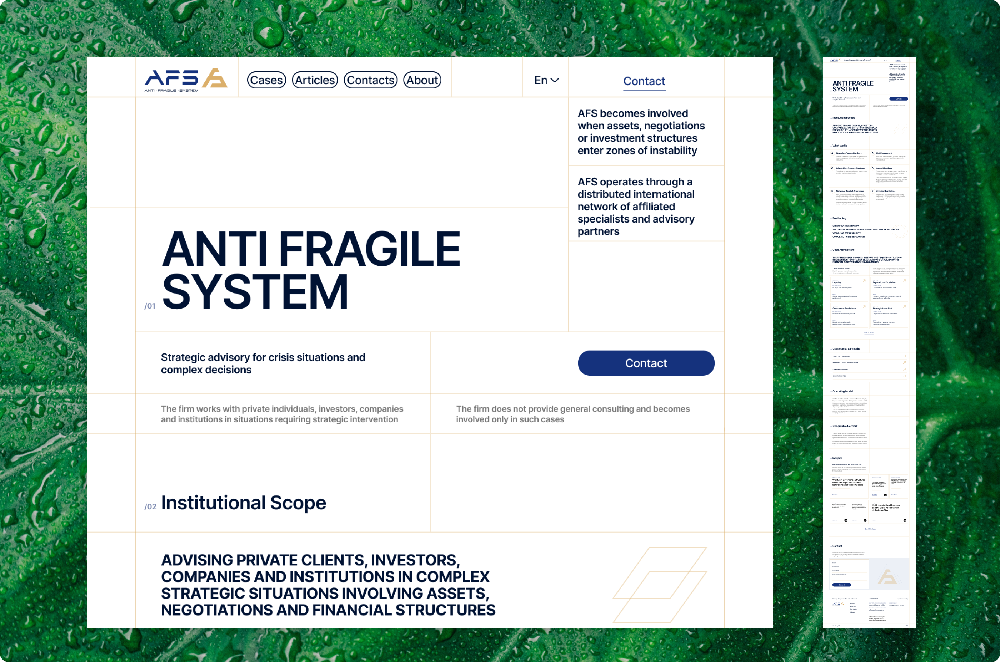

## 2. Brief

The brief set the tone before any layout existed: calm, serious, expensive without being loud. White background, deep blue type, gold used sparingly. No photographs of people, no stock imagery, no decorative icons. Architectural lines, fragments of structure, abstract geometry and minimal diagrams were welcome. The content was just as restricted: service directions are named but never explained, and the site never justifies itself or mentions anyone else.

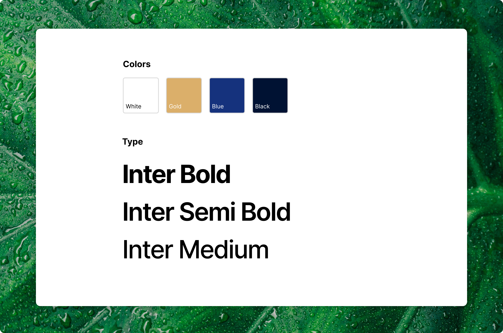

## 3. Five directions

I started with five answers to the same brief, each limited to the first three screens: the hero, the service directions and the positioning statement. They ranged from a centered classic layout to a type-led editorial one, a column grid, an architectural line grid and an option built around a single photograph. Keeping the scope small made them comparable: same content, five different ways of being restrained.

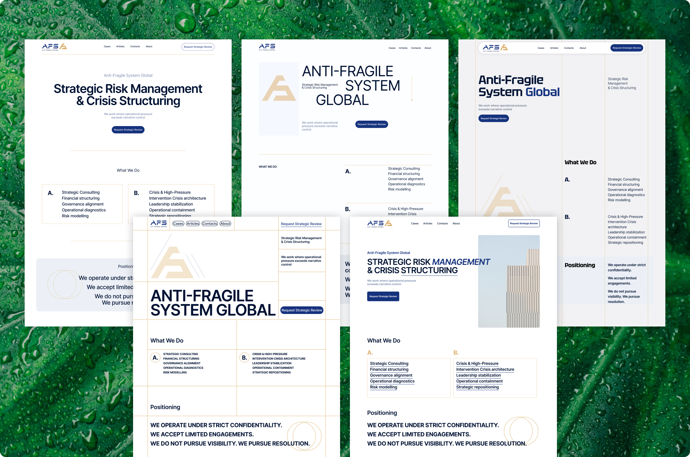

## 4. The chosen direction

The client chose the fourth direction. Its thin-line grid turns the brief’s architectural lines into the structure of the page rather than decoration on top of it. One change is worth mentioning: the concept carried a large gold brand mark in the hero that took up space without adding information. I removed it and left the company logo in the top left corner, where visitors expect it. What remains is the grid, a heading and a single call to action.

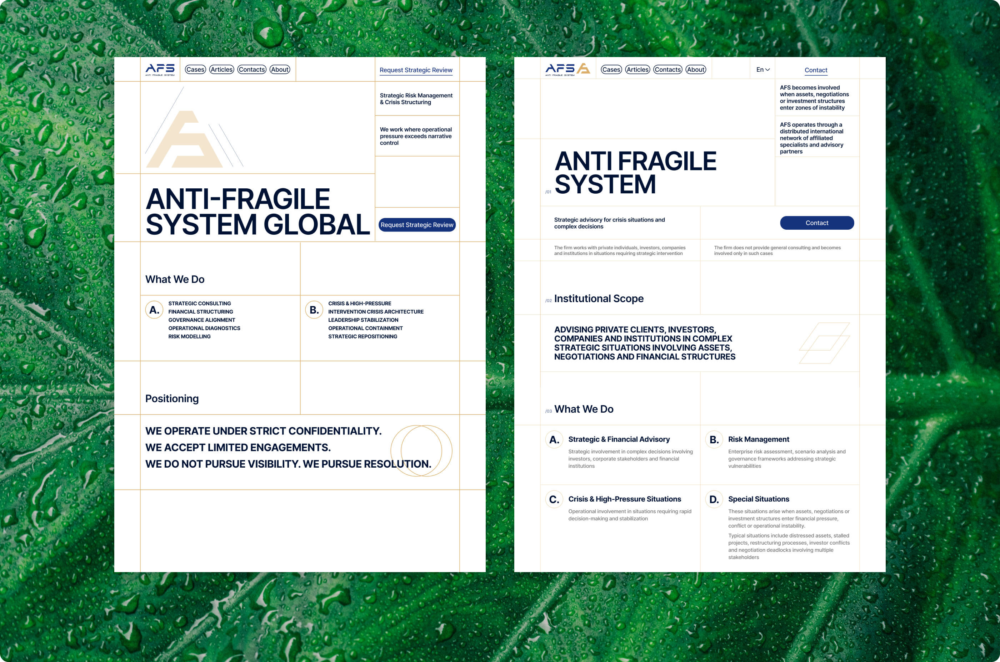

## 5. Homepage

5a. /01–/02 Every section is numbered and sits on the same line grid, so the page reads like an index. A visitor always knows where they are in the structure.

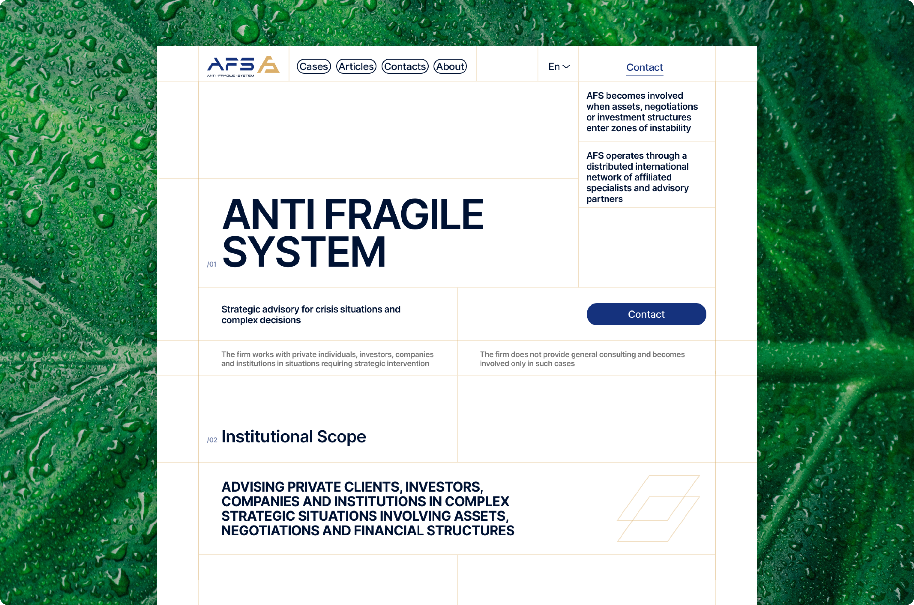

5b. /03 What We Do – Six service directions, lettered A to F in two columns. Each gets a title and two or three lines: enough to orient, not enough to explain the method, which the brief ruled out.

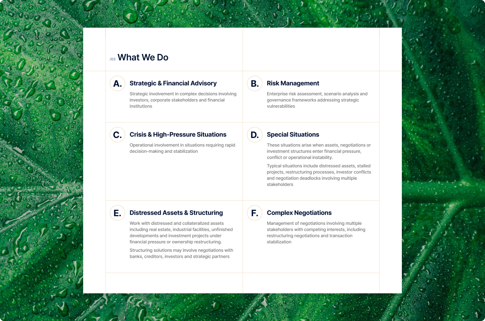

5c. /04–/05 The positioning statement is set in bold capitals with nothing competing with it. Cases appear as anonymous files: case type, scope, result. Experience is visible without naming anyone.

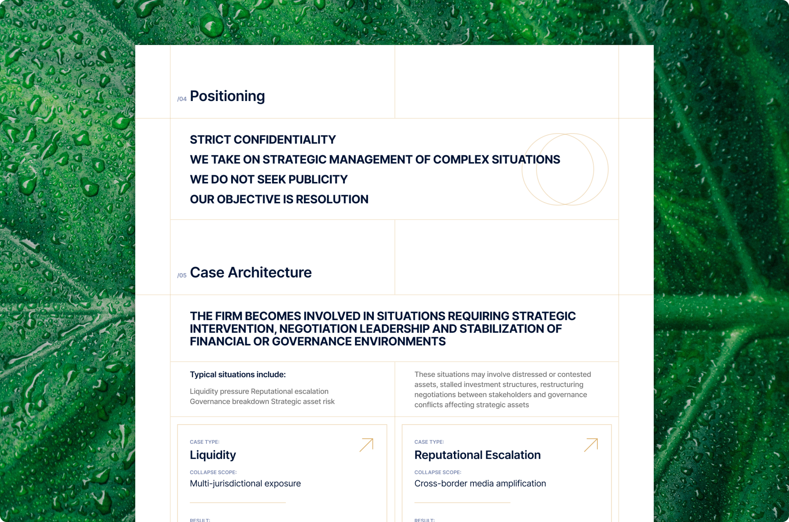

5d. /06–/10 Governance notices collapse into a list of links, the operating model and geography stay as quiet text blocks, and the insights section points to articles published elsewhere. The contact form is cut to four fields: name, company, contact and optional context.

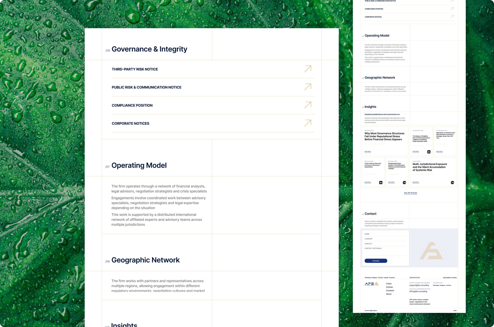

## 6. Long-form text

Much of this site is long, formal text: legal notices, the About page, articles. I built these pages on one reading style in Inter, with clear heading levels, numbered clauses and generous spacing, so a page of regulatory language can be scanned before it is read.

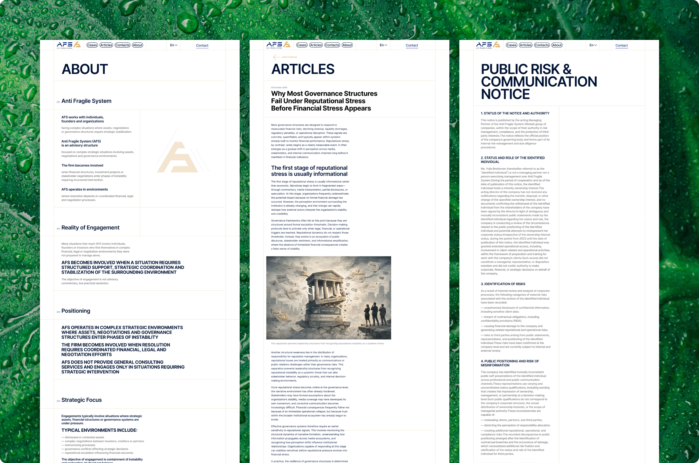

## 7. Cases and articles

Cases and articles share one list template: a grid of cards with small labels, type, scope and result for cases, date and source for articles. A case page opens with the same labels and then moves into long-form text with room for diagrams. Identical structure keeps publishing predictable for whoever maintains the site.

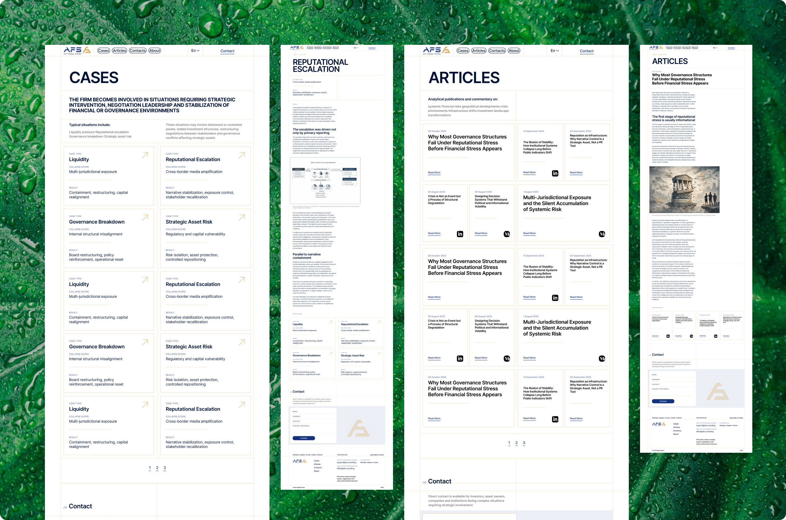

## 8. Mobile

On mobile the four-column grid collapses into a single column. Section numbers and thin dividers stay, so the structure remains readable, and navigation moves behind a menu. Forms and long texts were checked at narrow widths first, since that is where they break.

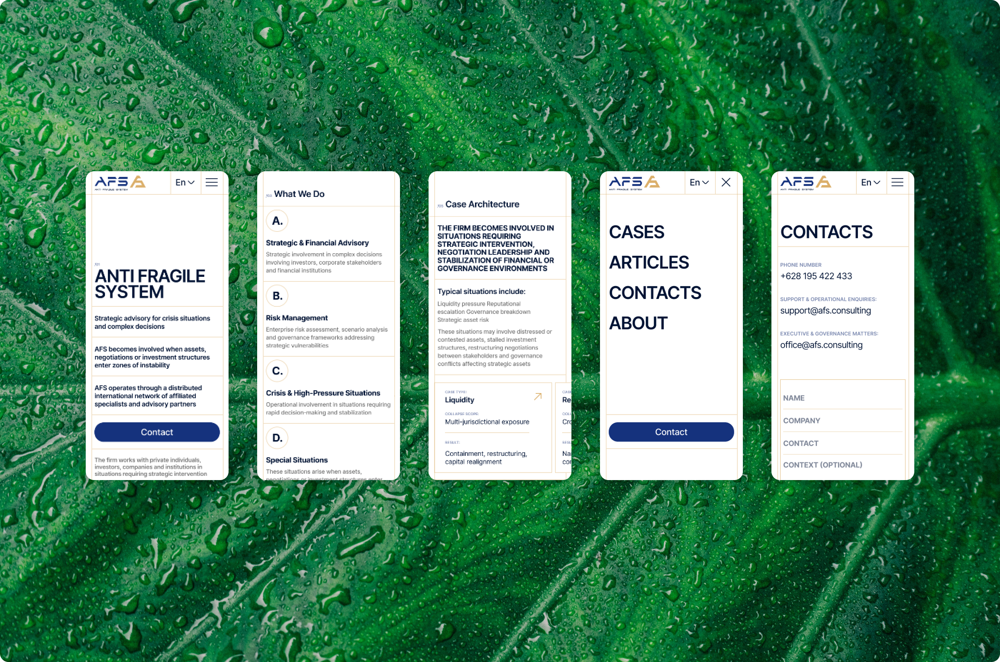

## 9. UI kit

The kit is deliberately small: inputs, buttons in their states, and the type and colors the pages are built from. Inter throughout, a four-column grid of 300 px columns, deep blue as the working color and gold reserved for accents.

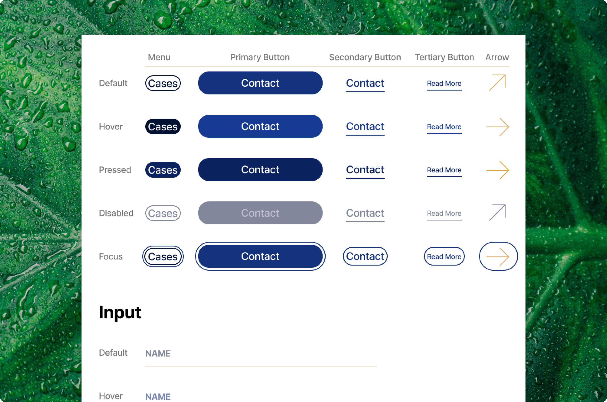

## 10. CMS

The site comes with a lightweight CMS built for one person: the client, who publishes everything herself. It covers sign-in with password recovery, a list of all cases and articles, separate editors for cases, articles and news, and a media library. With a single user and no roles or permissions to manage, I kept every screen to what publishing actually needs.

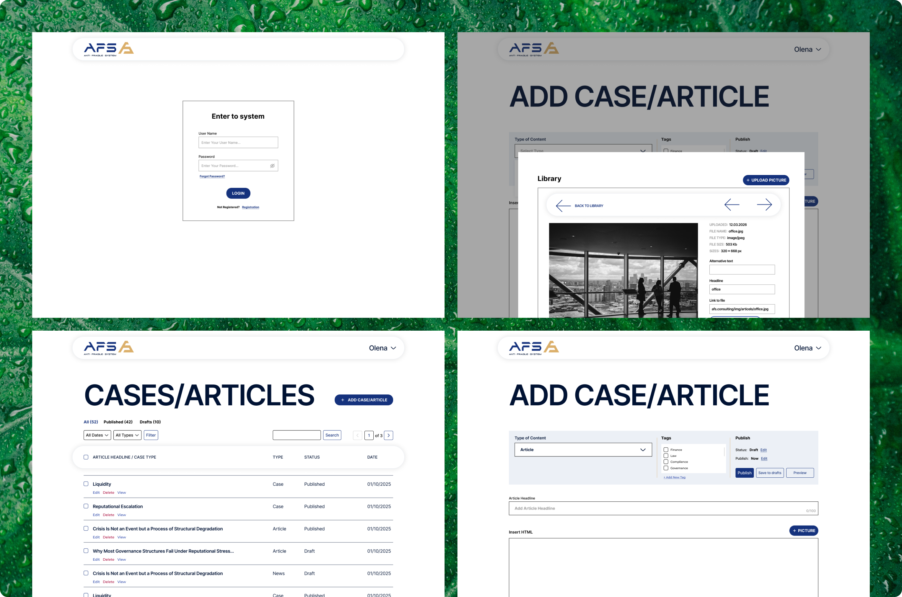
