## 1. Intro

Redesign of an independent news site about Crimea and the editorial CMS behind it. The old site looked dated, treated every kind of material the same way and made long articles hard to read. I kept the brand recognizable, gave each content type its own visual pattern, tuned article pages for long reading and quoting, added a blog platform, and designed the first version of a custom CMS to replace WordPress. I was the only designer on the project and supported development for nine months through launch.

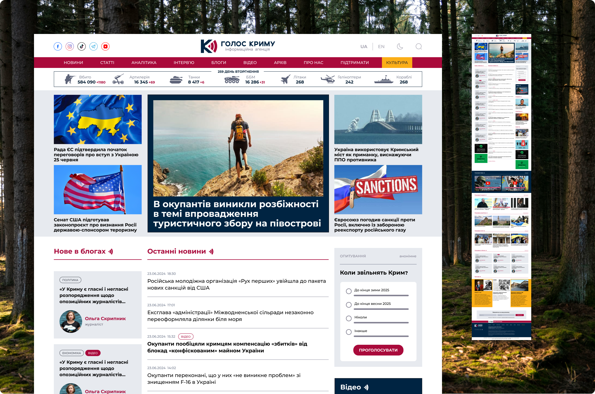

## 2. Starting point

The previous version had four problems. The design was dated. News, articles, analytics and interviews all looked the same, so a long analytical piece got the same treatment as a two-line news item. Article typography made reading tiring. And there was no real solution for blogs.

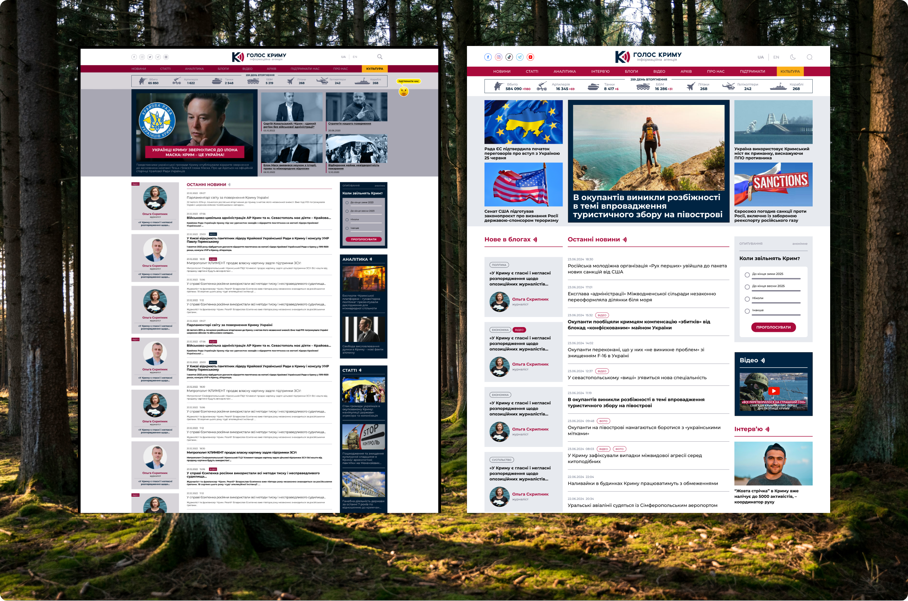

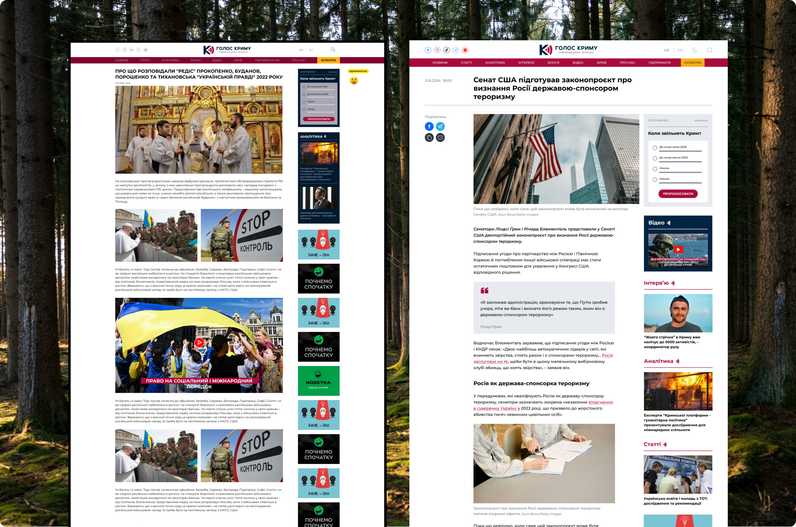

## 3. Brand and goals

The client wanted the site to keep its identity, so colors, typeface, logo and the homepage’s overall logic, with a central news feed, stayed. Everything around them changed: layout, hierarchy, article typography and a separate pattern for each content type. The other goals were to present the site as a reliable news source and to introduce blogs.

## 4. Homepage

The client wanted the site to stand apart from other news outlets and to have a character of its own, so I did not settle for one layout. I proposed ten variants of the lead news block and refined them from there. The final homepage works as a navigation and discovery center: a chronological feed for quick updates, highlighted materials above it, and separate blocks leading to analytics, interviews and video. It also connects to the agency’s YouTube and Telegram channels.

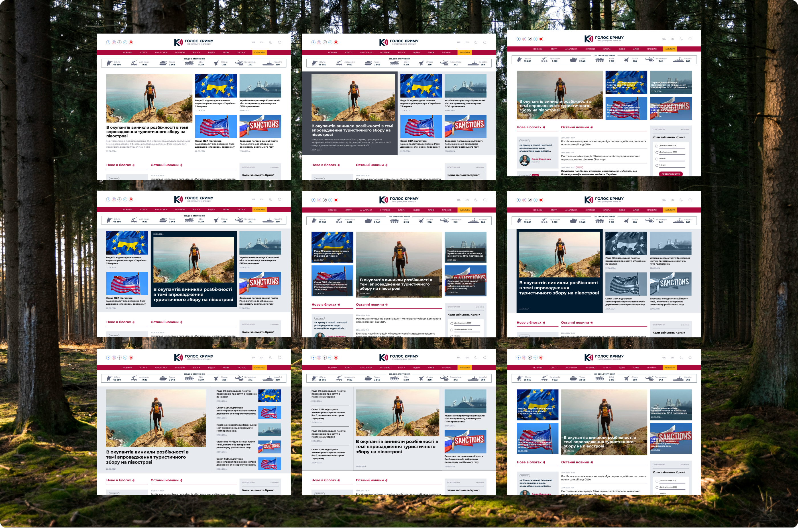

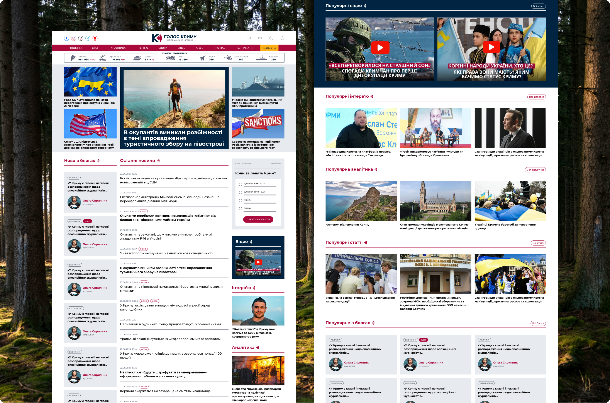

## 5. Content types

Each content type gets its own visual pattern, so the kind of material is recognizable at a glance. News uses a 640 px text column and a compact image. Articles open with a full-width hero image and use larger images inside the text. Analytics follows the article pattern, with a filter over the hero image and more charts and diagrams than photos. Interviews split the opening in half, with the image on one side and the headline on the other.

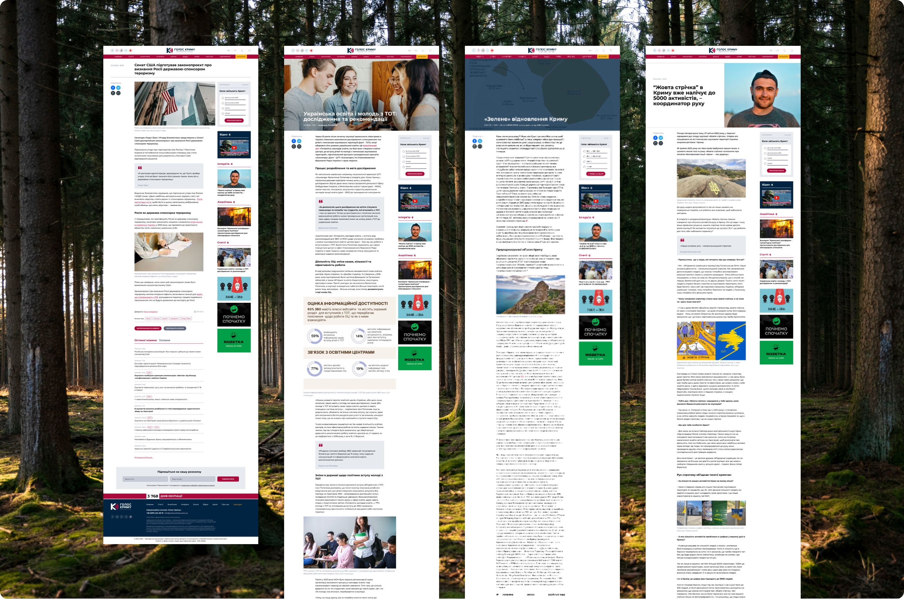

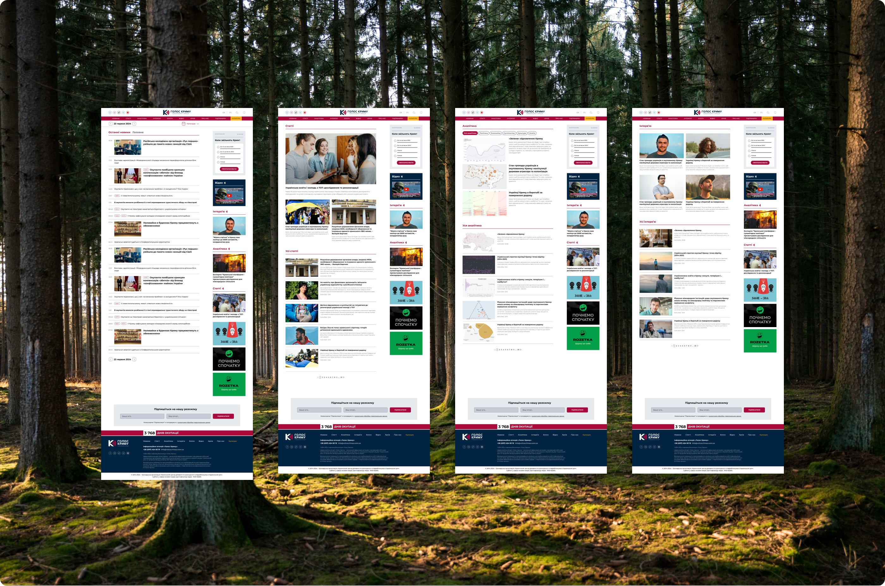

## 6. Reading and quoting

Article pages are built for long reading: controlled line length and spacing, a clear type hierarchy, a calm rhythm, and quote blocks that structure the narrative and make passages easy to cite.

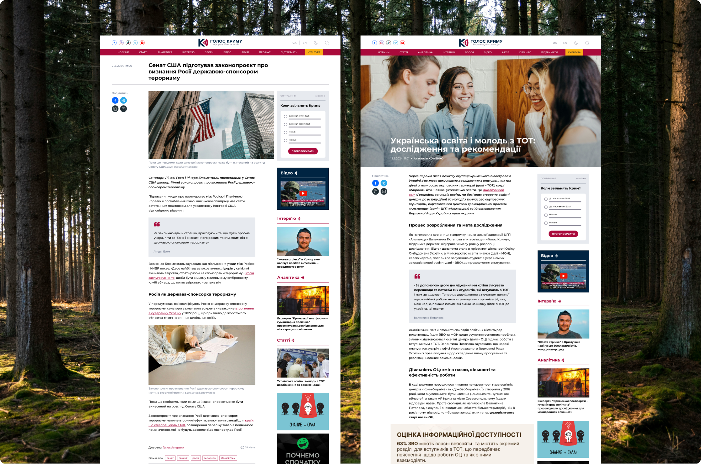

## 7. Blogs and authors

Anyone can apply to write a blog, and the editor-in-chief approves them as authors. The blog catalog lists every post, and each author page lists that author’s posts. Blogs live in their own section, so opinion pieces are easy to find without competing with the news flow. Posts follow the same reading layout as editorial content, with a clear label separating contributor writing from the editorial team’s publications.

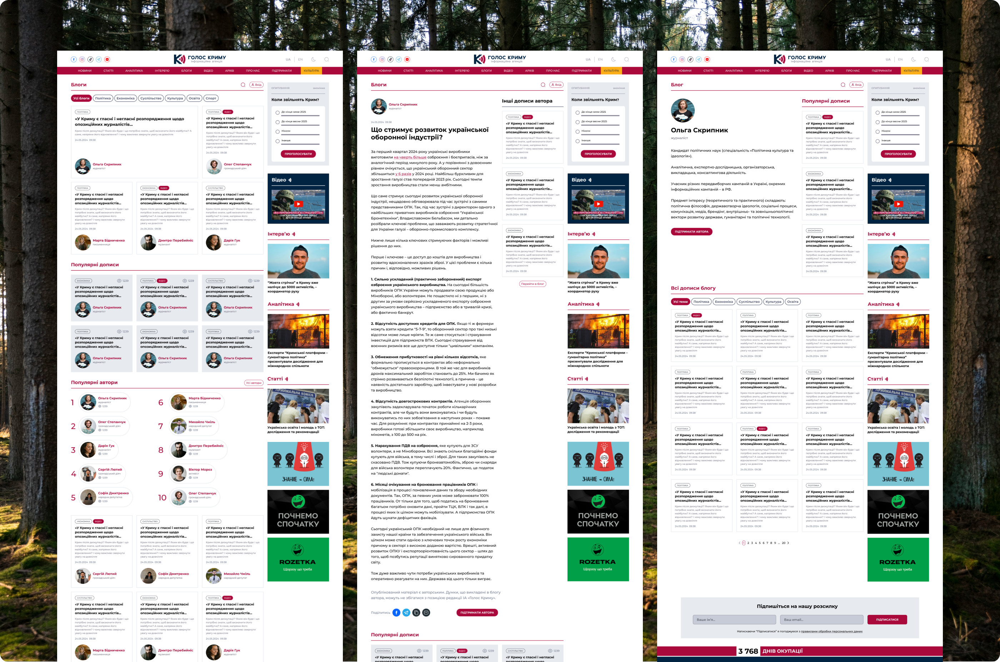

## 8. Dark theme, languages, mobile

The dark theme was a client request: competitors’ sites had one and they wanted the same. The site speaks three languages, Ukrainian, English and Russian. Articles are written in Ukrainian and translated automatically, so on the design side the only addition was a language switcher. The design covers desktop and mobile versions.

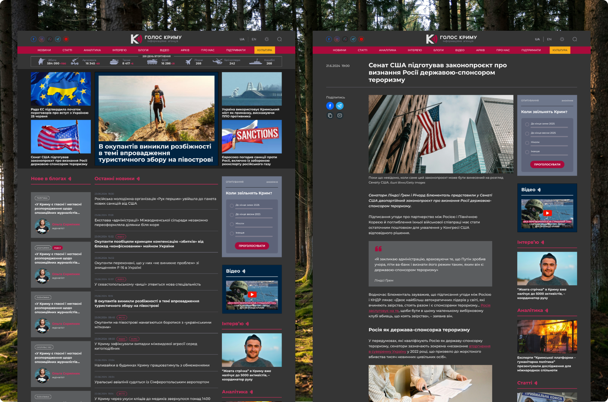

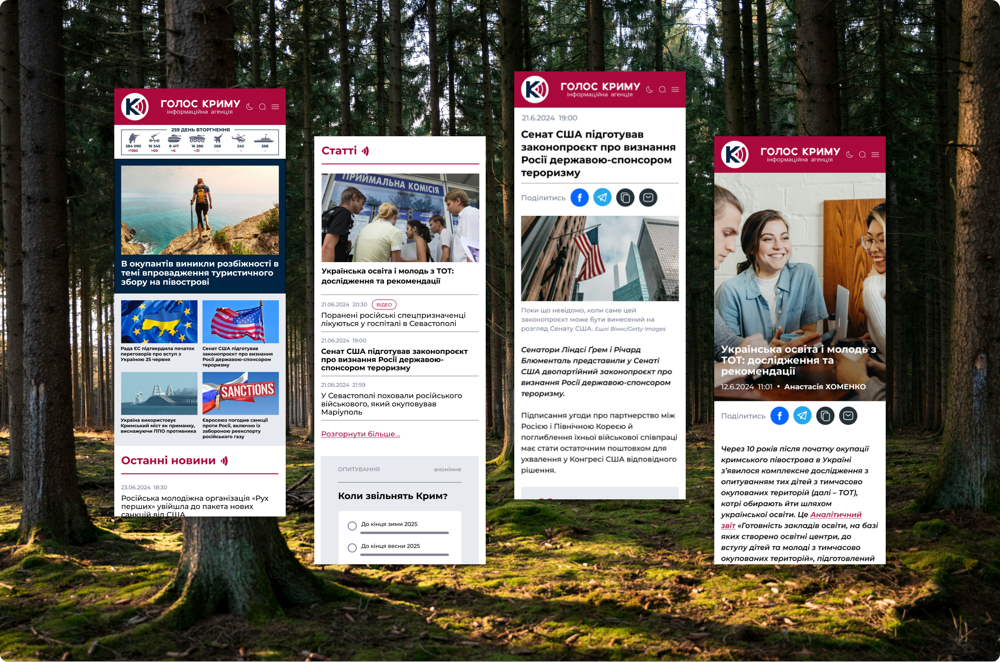

## 9. Editorial CMS

Before the redesign the editorial team ran the site on WordPress and missed some of the functionality they needed, so the decision was made to build a CMS from scratch. I designed it to feel like WordPress, so editors would not have to relearn their daily workflow, while the functions are tailored to this site: publishing and editing materials and managing users, authors and bloggers. It was designed with mobile use in mind. The screens here are the first version; developers and the editorial team kept refining it for some time after release.

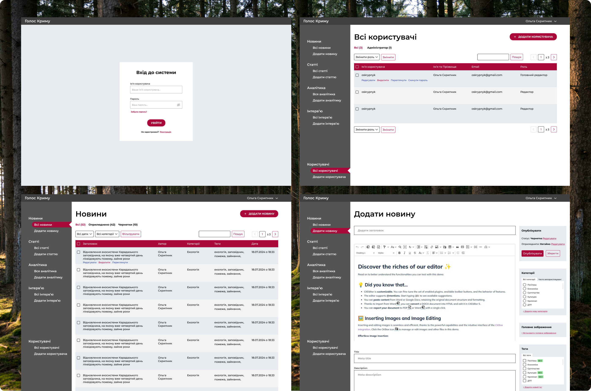

## 10. Everything else

The redesign also covers the About page with the agency’s mission and thematic projects, search with filters by material type, newsletter sign-up with email templates, an archive, and a 404 page.

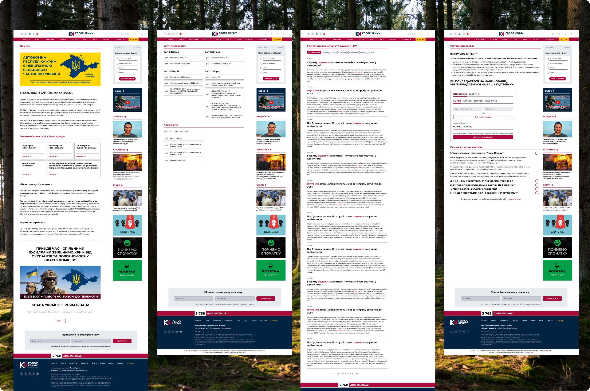

## 11. Budget and delivery

The project started with time estimates and budget calculations. It came to about 100 hours of design and revisions in total, which left little room for edge cases. After handoff I stayed in touch with the front-end engineer and helped implement what the design had not anticipated, prepared assets, and worked out the in-between responsive layouts together with him, since the design had only a desktop and a mobile version. I supported development for nine months through launch. Most design decisions were accepted without major pushback, and the site is live.
